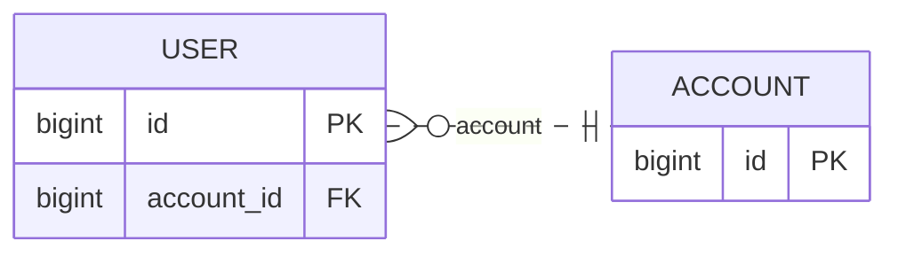

# rails-mmd

Generate Mermaid ER and class diagrams from the models and database schema of a Rails application. `rails-mmd` runs in the application's bundle, loads its models, and writes local `.mmd` files that you can preview in a Mermaid-compatible Markdown viewer.



The diagram above is illustrative. The actual output depends on your models, associations, and database metadata.

## Try it in a Rails app

In the **target Rails application's** `Gemfile`, install this repository directly from GitHub:

```ruby
gem 'rails-mmd', git: 'https://github.com/AudioStakes/rails-mmd.git', require: false
```

Run `bundle install`. The application's `Gemfile.lock` records the selected Git revision. At the application root, create `rails_mmd.yml` and replace the model names with real models in your app:

```yaml
version: 1
domains:
  core:
    include_models:
      - User
      - Post
output:
  directory: tmp/rails_mmd
  format: both
  attributes: keys
  direction: LR
```

Then run:

```sh
RAILS_ENV=development bundle exec rails-mmd generate
```

Inspect `tmp/rails_mmd/core.er.mmd` and `tmp/rails_mmd/core.class.mmd`. The selected environment must be able to boot and read its database schema. The command eager-loads the Rails application; run it only with an application and configuration you trust.

The configuration selects models explicitly for each domain. Relationships are drawn between supported models selected in the same domain. To see all options, output files, diagnostics, and exit codes, read [the usage guide](docs/usage.md).

## Compatibility and limits

The gem declares Ruby `>= 3.3, < 4.1`. The local real-app matrix verifies Rails 7.2 on Ruby 4.0.6, and Rails 8.1 on Ruby 3.3.12 and 4.0.6. Other combinations within the Ruby range have not been verified by that matrix.

Supported associations and current limits are listed in the [Active Record support matrix](docs/active-record-association-support.md). In particular, a domain spanning multiple database connection contexts is unsupported, as are composite keys and several association options. Check diagnostics when a diagram omits a relationship.

Generated diagrams and JSON artifacts can reveal model names, table names, columns, relationships, and connection identifiers in diagnostics. Review them before committing or sharing them. For private application schemas, keep the output directory out of the application's Git repository or add it to its `.gitignore`.

## Contributing and development

See [CONTRIBUTING.md](CONTRIBUTING.md) for local setup and checks. Implementation contracts are in [docs/p0-contract.md](docs/p0-contract.md); the [development notes](docs/development/tooling.md) cover the Rake tasks. Serena is optional local development tooling, not a runtime dependency.

## License

MIT. See [LICENSE](LICENSE).
