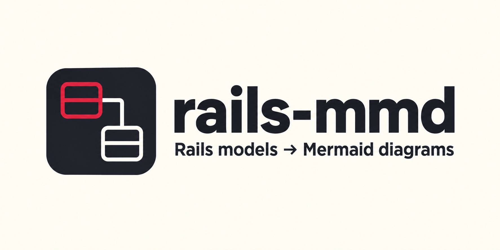
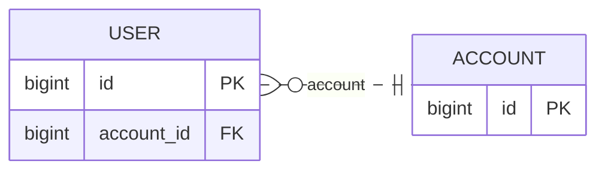

# rails-mmd



Generate Mermaid ER and class diagrams from the models and database schema of a Rails application. `rails-mmd` runs in the application's bundle, loads its models, and writes local `.mmd` source files. Preview them with a Mermaid viewer or embed their contents in a Markdown `mermaid` code block.



The diagram above is illustrative. The actual output depends on your models, associations, and database metadata.

## Try it in a Rails app

You need an existing Rails application with Active Record models and a prepared database. Check the [tested Ruby/Rails combinations](#compatibility-and-limits) below before installing. All commands in this section run from that application's root, not this repository.

In the **target Rails application's** `Gemfile`, install this repository directly from GitHub:

```ruby
gem 'rails-mmd', git: 'https://github.com/AudioStakes/rails-mmd.git', require: false
```

Run `bundle install`. The application's `Gemfile.lock` records the selected Git revision. At the application root, create `rails_mmd.yml` and replace the model names with real models in your app:

```yaml
version: 1
domains:
  core:
    include_models:
      - User
      - Post
output:
  directory: tmp/rails_mmd
  format: both
  attributes: keys
  direction: LR
```

Then run:

```sh
RAILS_ENV=development bundle exec rails-mmd generate
```

Inspect `tmp/rails_mmd/core.er.mmd` and `tmp/rails_mmd/core.class.mmd`. A successful run can be silent; these generated files are the result. To view the diagrams, follow [Viewing a generated diagram](docs/usage.md#viewing-a-generated-diagram). The selected environment must be able to boot and read its database schema. The command eager-loads the Rails application; run it only with an application and configuration you trust.

The configuration selects models explicitly for each domain. Relationships are drawn between supported models selected in the same domain. To see all options, output files, diagnostics, and exit codes, read [the usage guide](docs/usage.md).

## Compatibility and limits

The gem declares Ruby `>= 3.3, < 4.1`. The local real-app matrix verifies Rails 7.2 on Ruby 4.0.6, and Rails 8.1 on Ruby 3.3.12 and 4.0.6. Other combinations within the Ruby range have not been verified by that matrix. The real-app matrix uses SQLite; PostgreSQL and MySQL have not been verified in a real-app run.

Supported associations and current limits are listed in the [Active Record support matrix](docs/active-record-association-support.md). In particular, a domain spanning multiple database connection contexts is unsupported, as are composite keys and several association options. Check diagnostics when a diagram omits a relationship.

Generated diagrams and JSON artifacts can reveal model names, table names, columns, relationships, and connection identifiers in diagnostics. Review them before committing or sharing them. Output must stay inside the application's root; for private schemas, add the output directory to the application's `.gitignore` (for this example, `/tmp/rails_mmd/`).

See the [security policy](https://github.com/AudioStakes/rails-mmd/blob/main/SECURITY.md) for the Rails boot trust boundary and vulnerability reporting.

## How it works

The [generation pipeline](https://github.com/AudioStakes/rails-mmd/blob/main/lib/rails_mmd/generation_pipeline.rb) separates model inventory, domain selection, schema probing, relationship construction, and rendering. It converts Rails metadata into an intermediate representation and validated render plans; Mermaid serialization consumes those plans without querying Rails or the database.

Relationship cardinality uses database foreign-key, nullability, and unique-index evidence. Structured diagnostics explain omitted unsupported associations and degraded metadata. The [pipeline specs](https://github.com/AudioStakes/rails-mmd/blob/main/spec/rails_mmd/generation_pipeline_spec.rb) exercise these stages together, and the [publisher specs](https://github.com/AudioStakes/rails-mmd/blob/main/spec/rails_mmd/publisher_spec.rb) cover validation, selected-domain output, and rollback when file replacement fails. The [real-app matrix](https://github.com/AudioStakes/rails-mmd/blob/main/docs/development/ci.md) checks the public command against the declared Ruby/Rails pairs.

## Contributing and development

See [CONTRIBUTING.md](https://github.com/AudioStakes/rails-mmd/blob/main/CONTRIBUTING.md) for local setup and checks. Implementation contracts are in [docs/p0-contract.md](https://github.com/AudioStakes/rails-mmd/blob/main/docs/p0-contract.md); the [development notes](https://github.com/AudioStakes/rails-mmd/blob/main/docs/development/tooling.md) cover the Rake tasks. These contributor resources are maintained in the repository, outside the installed gem. Serena is optional local development tooling, not a runtime dependency.

The [P0 blocking fixture matrix](https://github.com/AudioStakes/rails-mmd/blob/main/docs/p0-blocking-fixture-matrix.md) records the required verification cases.

## License

MIT. See [LICENSE](LICENSE).
